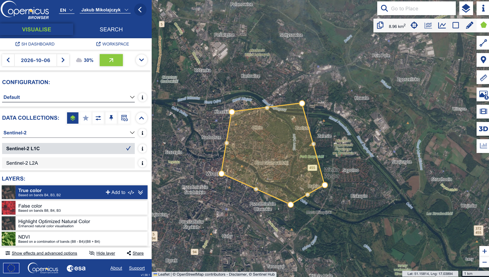
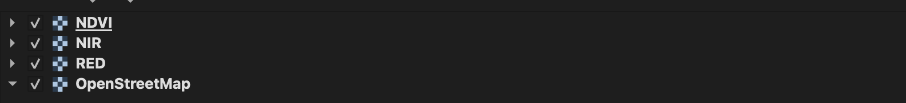
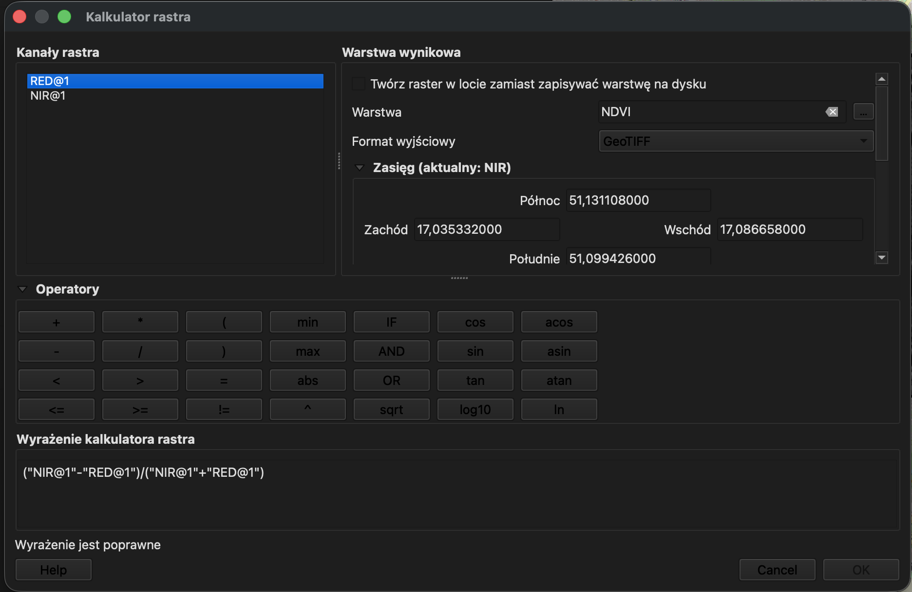
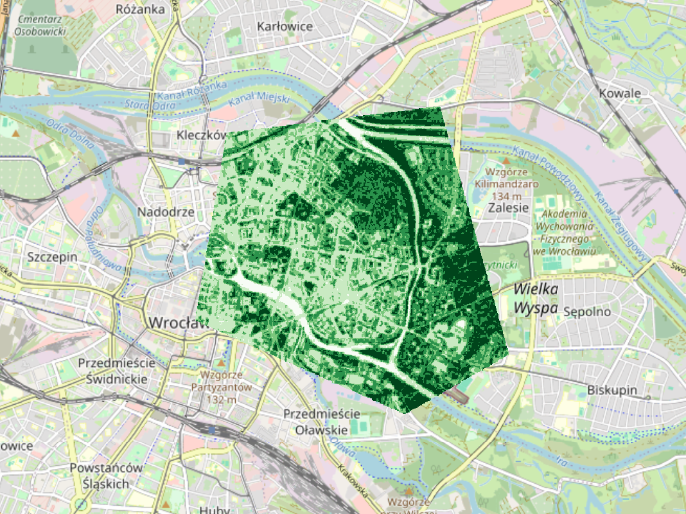

# Sprawozdanie - Obliczanie wskaźnika NDVI (Copernicus, QGIS)

## 1. Wstęp
Celem zadania było pobranie danych satelitarnych z serwisu Copernicus Browser oraz obliczenie i wizualizacja wskaźnika wegetacyjnego NDVI (Normalized Difference Vegetation Index) dla wybranego obszaru w programie QGIS.

Wskaźnik NDVI pozwala określić stan i gęstość roślinności na podstawie różnicy odbicia promieniowania w paśmie bliskiej podczerwieni (NIR) oraz paśmie czerwonym (RED):

$$NDVI = \frac{NIR - RED}{NIR + RED}$$

## 2. Pobieranie danych z Copernicus Browser

1. Po zalogowaniu w serwisie https://browser.dataspace.copernicus.eu/ zaznaczono obszar zainteresowania obejmujący fragment Wrocławia (okolice Placu Grunwaldzkiego, Ołbina oraz Odry).
2. Wybrano zdjęcie z satelity Sentinel-2 L1C z dnia 2026-10-06.



3. W oknie pobierania w zakładce Analytical ustawiono format TIFF (32-bit float), wysoką rozdzielczość i zaznaczono dwie warstwy potrzebne do obliczeń:
   - B04 (pasmo czerwone - RED),
   - B08 (bliska podczerwień - NIR).

## 3. Przygotowanie warstw w QGIS

1. W programie QGIS utworzono nowy projekt i dodano mapę podkładową OpenStreetMap.
2. Załadowano pobrane pliki TIFF i zmieniono ich nazwy, żeby ułatwić późniejsze obliczenia:
   - pasmo B04 zmieniono na `RED`,
   - pasmo B08 zmieniono na `NIR`.



## 4. Obliczenie NDVI

1. Z menu wybrano `Raster -> Kalkulator rastra...`.
2. Wpisano wzór na NDVI:
   ```text
   ("NIR@1"-"RED@1")/("NIR@1"+"RED@1")
   ```
3. Wynik zapisano jako warstwę `NDVI` w formacie GeoTIFF.



## 5. Wizualizacja i wnioski

We właściwościach warstwy `NDVI` (`Właściwości -> Styl`) zmieniono wyświetlanie na `Jednokanałowy pseudokolor` (Singleband pseudocolor) z zieloną paletą barw.



Na wygenerowanej mapie dobrze widać zróżnicowanie terenu:
- najniższe wartości (kolor biały / bardzo jasny) to woda (Odra i kanały) oraz gęsta zabudowa i ulice,
- średnie wartości (jasny zielony) odpowiadają zabudowie miejskiej z niewielką ilością zieleni (np. Ołbin, okolice Placu Grunwaldzkiego),
- najwyższe wartości (ciemny zielony) pokrywają się z terenami zielonymi - Parkiem Szczytnickim, ogródkami działkowymi, Zaciszem oraz zielenią wzdłuż Odry.
