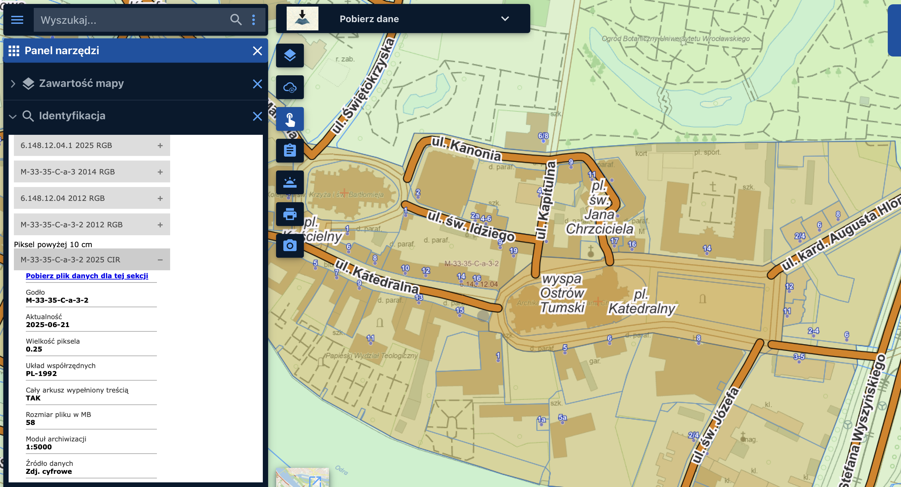
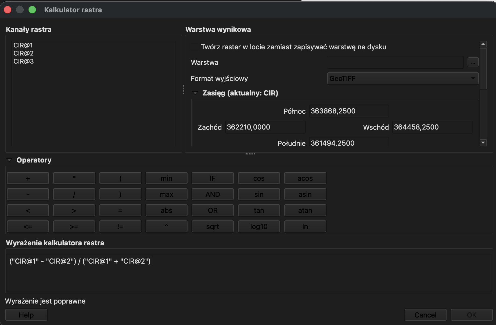
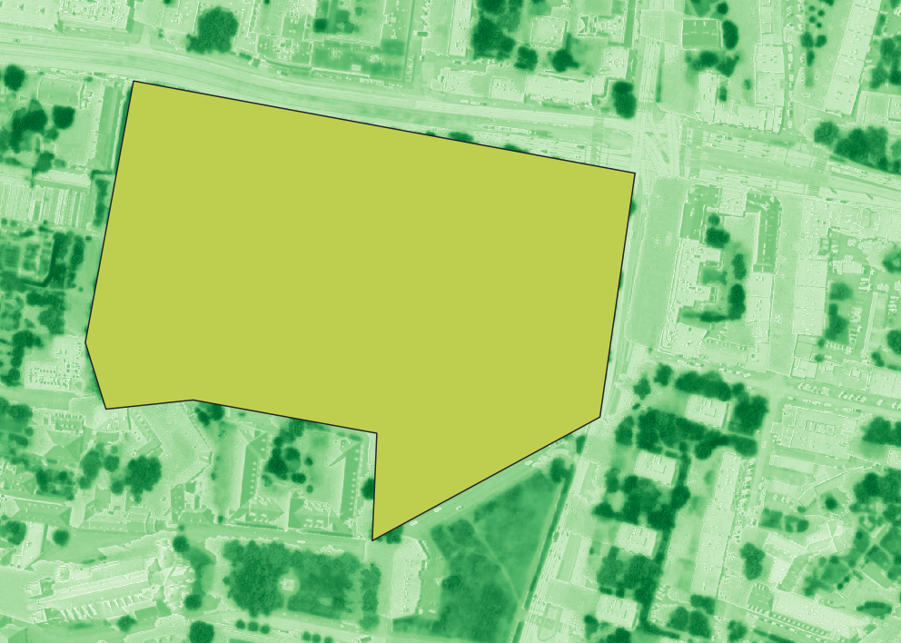
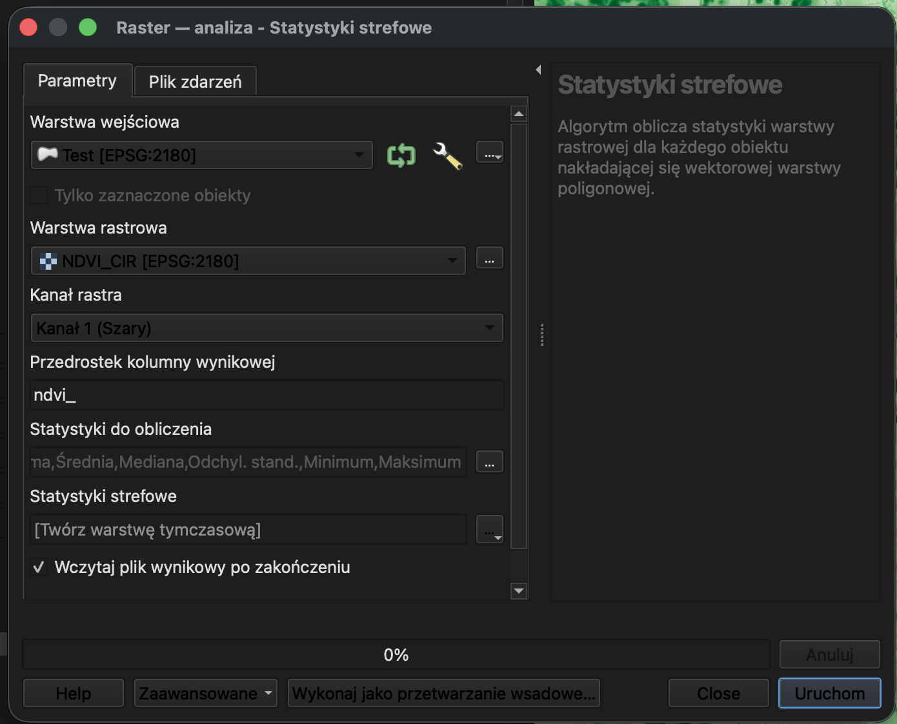
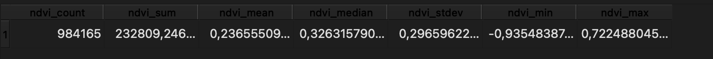

# Sprawozdanie - Obrazowanie CIR i statystyki strefowe NDVI (Geoportal, QGIS)

## 1. Wstęp
Celem zadania było pobranie ortofotomapy typu CIR z serwisu Geoportal, obliczenie dla niej wskaźnika NDVI w programie QGIS oraz wyznaczenie statystyk strefowych (Zonal Statistics) dla wybranego obszaru.

W zdjęciach CIR roślinność mocno odbijająca bliską podczerwień (NIR) jest widoczna w czerwonych odcieniach. Kanały zdjęcia odpowiadają kolejno:
- kanał 1 - bliska podczerwień (NIR),
- kanał 2 - pasmo czerwone (R),
- kanał 3 - pasmo zielone (G).

Wzór na NDVI:

$$NDVI = \frac{NIR - R}{NIR + R}$$

## 2. Pobranie danych z Geoportalu

1. Na stronie https://www.geoportal.gov.pl/ w sekcji `Pobierz dane` włączono warstwę `Dane do pobrania -> Ortofotomapa -> Ortofotomapa wg rozdzielczości`.
2. Zaznaczono arkusz `M-33-35-C-a-3-2` z dnia 2025-06-21 (rozdzielczość 0.25 m, układ PL-1992 / EPSG:2180), który obejmuje okolice Ostrowa Tumskiego i Ogrodu Botanicznego we Wrocławiu, i pobrano plik GeoTIFF.



## 3. Obliczenie NDVI w QGIS

1. Pobrany plik wczytano do QGIS i zmieniono nazwę warstwy na `CIR`.
2. Wybrano `Raster -> Kalkulator rastra...`.
3. Ponieważ kanał 1 to NIR, a kanał 2 to R, wpisano wzór:
   ```text
   ("CIR@1" - "CIR@2") / ("CIR@1" + "CIR@2")
   ```
4. Wynik zapisano jako `NDVI_CIR.tif`, a w opcjach stylu ustawiono `Jednokanałowy pseudokolor` z zieloną paletą barw.



## 4. Warstwa tymczasowa i statystyki strefowe

1. Utworzono nową warstwę tymczasową typu poligon (`Test`, układ EPSG:2180) i obrysowano na niej teren Ogrodu Botanicznego.



2. W panelu `Algorytmy` uruchomiono `Statystyki strefowe` (`Zonal statistics`). Jako warstwę wektorową wybrano `Test`, a jako raster `NDVI_CIR`. Zaznaczono podstawowe statystyki do policzenia (liczba, suma, średnia, mediana, odchylenie standardowe, min, max).



## 5. Wyniki i wnioski

Po otwarciu tabeli atrybutów otrzymano następujące wartości dla zaznaczonego obszaru:
- `ndvi_count` (liczba pikseli): 984 165
- `ndvi_sum` (suma): 232 809,25
- `ndvi_mean` (średnia): 0,24
- `ndvi_median` (mediana): 0,33
- `ndvi_stdev` (odchylenie standardowe): 0,30
- `ndvi_min` (minimum): -0,94
- `ndvi_max` (maksimum): 0,72



Średnia na poziomie 0,24 i mediana 0,33 pokazują, że większość badanego terenu zajmuje roślinność. Najwyższe wartości (do 0,72) przypadają na drzewa i gęstą zieleń, natomiast wartości ujemne (do -0,94) oraz spore odchylenie standardowe (0,30) wynikają z tego, że w granicach Ogrodu Botanicznego znajdują się też stawy, ścieżki i budynki.
